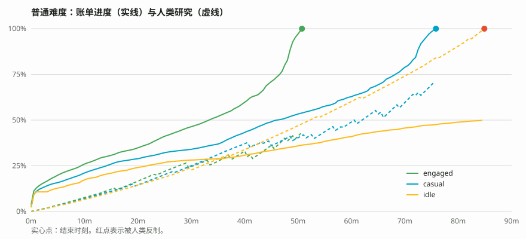

# 数值平衡报告

> 由 `npm run report` 生成。数值改动后重跑，这份报告和图会一起更新。

## 结论

目标：中篇，首次通关 10 到 20 小时。三种机器人玩家用真实的逻辑核心从零玩到结局：

| 玩家 | 进入海啸 | 进入兽群 | 进入远古 | 结局 | 结局前进化次数 |
|---|---|---|---|---|---|
| engaged | 34 分钟 | 1.4 小时 | 4.3 小时 | 10.6 小时 | 6 |
| casual | 42 分钟 | 1.8 小时 | 4.5 小时 | 10.9 小时 | 9 |
| idle | 50 分钟 | 2.5 小时 | 6.2 小时 | 15.2 小时 | 9 |

- **engaged**：投入型：常驻页面，最优购买，按收益峰值进化
- **casual**：休闲型：每分钟看一次，偶尔点击和放大潮
- **idle**：挂机型：每 5 分钟看一次，几乎不点击

机器人买东西从不犹豫，真人通常慢 20% 到 50%，所以真人首通预计在 12 到 20 小时。

## 节奏

- **前 30 分钟**：每 1 到 5 分钟解锁一种新生物或升级。参考 Cookie Clicker：开局几分钟内就有反馈。
- **虫潮 → 海啸**：约 35 到 50 分钟。门票"唤醒大海"的价格等于第一只螃蟹的价格。
- **兽群**：第一次撞墙。第一次进化在 3.5 到 6.5 小时之间，拿到 40 到 600 个基因。
- **远古**：基因开始滚雪球，几次 10 到 30 分钟的短进化就能把数字推高好几个数量级。之后进入软上限区，最后一张账单要靠耐心攒。
- **结局后**：进入无尽模式，排行榜继续累计。

## 核心公式

| 公式 | 取值 | 参考 |
|---|---|---|
| 下一只的价格 = 基础价 × 1.15^已拥有 | 增长率 1.15 | Cookie Clicker 建筑 |
| 产出 = 基础产出 × 数量 × 倍率 | 数量 = 购买 + 繁殖 | The Math of Idle Games |
| 拥有 10、25、50、100、150、200… 只时产出 ×2 | 共 12 档 | AdVenture Capitalist 阈值倍率 |
| 相邻生物价格 ×10，产出 ×7.5 | 回本时间每档 ×1.33 | 让高阶生物值得等待 |
| 基因总数 = ⌊∛(累计破坏 / 10B)⌋ | 立方根 | Cookie Clicker 声望 |
| 每个基因 +5% 产出，超过 1000 个后按 ^0.5 软上限 | 抑制后期爆炸 | Antimatter Dimensions 软上限 |
| 买最大数量 = ⌊log_r(c(r−1)/(b·r^k) + 1)⌋ | 单一指数成本可用 | The Math of Idle Games |

## 时代机制

- **虫潮·繁殖**：买下"蚁后登基"后，每只购买的昆虫每秒繁殖 0.0002 × 蚁后数 × 繁殖倍率 只。繁殖出的个体不抬价，但会产出。这是"产出的增速本身也在涨"的导数式增长（Antimatter Dimensions）。
- **海啸·潮汐**：海洋生物产出 × (1 + 振幅 × 潮位)，潮位按 120 秒正弦周期在 0 和 1 之间变化。"大潮"让产出 ×2 持续 30 秒，冷却 180 秒。后台补算用解析积分，结果和逐帧累加一致。
- **兽群、远古**：专属机制放在第二版。

## 生物配置表

| 时代 | 生物 | 基础价 | 基础产出 | 基础回本 |
|---|---|---|---|---|
| 虫潮 | 蚂蚁 | $15 | 0.2/秒 | 75 秒 |
| 虫潮 | 蚱蜢 | $150 | 1.1/秒 | 136 秒 |
| 虫潮 | 胡蜂 | $1.5K | 8.4/秒 | 178 秒 |
| 虫潮 | 锹甲 | $15K | 63/秒 | 236 秒 |
| 虫潮 | 螳螂 | $150K | 470/秒 | 319 秒 |
| 海啸 | 螃蟹 | $1.5M | 3.6K/秒 | 416 秒 |
| 海啸 | 水母 | $15M | 27K/秒 | 555 秒 |
| 海啸 | 海鳗 | $150M | 200K/秒 | 750 秒 |
| 海啸 | 章鱼 | $1.5B | 1.5M/秒 | 1K 秒 |
| 海啸 | 鲨鱼 | $15B | 11M/秒 | 1.36K 秒 |
| 兽群 | 老鼠 | $150B | 84M/秒 | 1.78K 秒 |
| 兽群 | 鸽子 | $1.5T | 630M/秒 | 2.38K 秒 |
| 兽群 | 狐狸 | $15T | 4.8B/秒 | 3.12K 秒 |
| 兽群 | 熊 | $150T | 36B/秒 | 4.16K 秒 |
| 兽群 | 大象 | $1.5Qa | 270B/秒 | 5.55K 秒 |
| 远古 | 迅猛龙 | $15Qa | 2T/秒 | 7.5K 秒 |
| 远古 | 翼龙 | $150Qa | 15T/秒 | 10K 秒 |
| 远古 | 三角龙 | $1.5Qi | 110T/秒 | 13.6K 秒 |
| 远古 | 腕龙 | $15Qi | 850T/秒 | 17.6K 秒 |
| 远古 | 霸王龙 | $150Qi | 6.3Qa/秒 | 23.8K 秒 |

最后一张账单"人类账单结清"售价 $4.5Oc，需要 25 只霸王龙。

## 怎么调

所有数值都在 `src/core/config/`：

- 想让整体变快或变慢：改 `creatures.ts` 里的 `COST_STEP` / `PROD_STEP`。
- 想让进化更早或更晚：改 `balance.ts` 里的 `genes.base`。
- 想改通关时长：改 `upgrades.ts` 里 `ending` 的价格。

改完运行 `npm run report`，看表和图是否还在目标区间。
